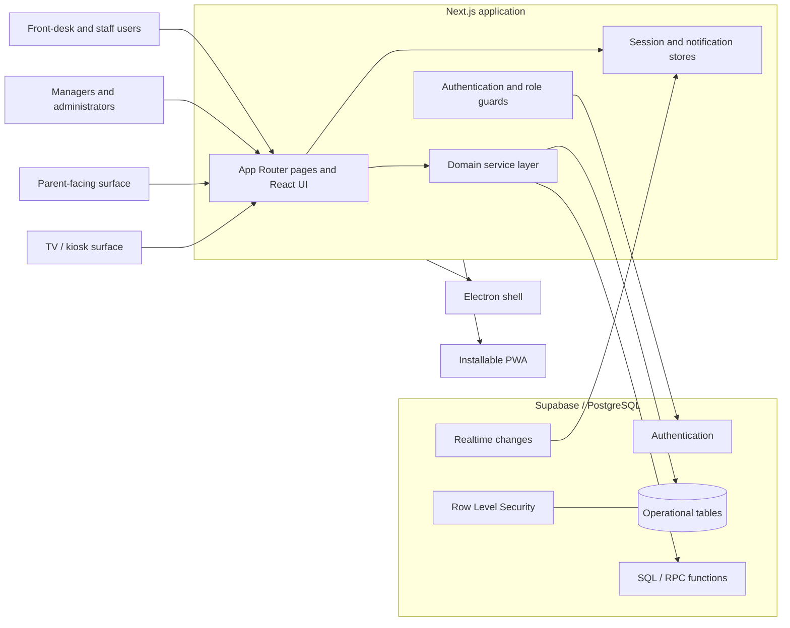

# Architecture Overview

This document summarizes architecture that was directly observable in the private Go Kids Play codebase. It intentionally omits credentials, infrastructure addresses, production data and implementation-level source code.

## System context

## Application layer

The application uses the Next.js 14 App Router with client-side React components for operational workspaces. Major route groups cover:

- dashboard and live operations;
- quick registration and active sessions;
- CRM, memberships and wallet operations;
- birthday organizations;
- reports and day-end closing;
- staff, branches, permissions and audit views;
- retail, inventory and waste;
- parent-facing and TV/kiosk surfaces.

Shared providers in the root layout coordinate authentication, branch context, settings, session locking, realtime supervision, notifications, network state and PWA behavior.

## Domain services

UI components call domain-focused TypeScript services rather than embedding every query in the view layer. Inspected services cover customers, memberships, sessions, finance, cash registers, birthday organizations, reports, staff directories, shifts, retail, inventory, notifications and branch management.

This separation makes the operational workflows visible at two levels:

1. React components coordinate user interaction and presentation.
2. Service functions translate those actions into Supabase queries or database RPC calls.

## Data and transactional boundaries

The repository contains a sequence of PostgreSQL migrations for core operational tables and functions. Verified examples include:

- memberships and membership pauses;
- cash-register closing records;
- birthday organizations and packages;
- branch records and branch identifiers on operational tables;
- retail checkout, void, stock and waste workflows;
- reporting functions for revenue, attendance, traffic and operational analysis;
- staff account lifecycle and permission-related fields.

Multi-step operations such as membership changes, register closing, session finance and retail checkout are represented by SQL/RPC functions. This moves important consistency boundaries closer to the data layer instead of relying only on a sequence of browser requests.

## Access model

The TypeScript permission model defines roles for super administrators, administrators, managers, managers with restricted scope, staff and cashiers. Access is evaluated at route and module level, with optional per-user permission overrides.

The database migrations add branch-aware policies and Row Level Security to operational tables. The codebase therefore contains both application-side navigation guards and database-side access controls. This review confirms their presence, not their complete security effectiveness in a deployed environment.

## Live session model

The shared session store:

- loads active sessions through the session service;
- subscribes to Supabase Realtime changes;
- converts database rows into UI session models;
- maintains local countdown state;
- handles pause, resume, extension and completion actions;
- resynchronizes after connectivity or visibility changes;
- records a bounded local event feed for the interface.

The active-session screen supports filtering and multiple display densities, including a table view intended for high-volume operational use.

## Reporting model

The reporting workspace applies a shared date-range context to multiple panels. Database functions and service calls provide period revenue, payment breakdowns, attendance, traffic, peak hours, customer insights, organization analytics, package performance and staff performance. Retail, waste, discounts, day-end records and operational notes are presented in dedicated panels.

## Delivery surfaces

The project includes:

- a PWA manifest with standalone display configuration and operational shortcuts;
- mobile-responsive navigation and parent-facing screens;
- TV/kiosk-oriented routes;
- Electron configuration for macOS, Windows and Linux packaging.

These files demonstrate configured delivery paths. This review does not independently verify published packages.

## Reliability-related components

The codebase contains helpers for retry behavior, safe asynchronous execution, idempotency, audit logging, network status and realtime reconnection. The session store uses reconnect signals to refresh state and reduce stale operational views after connectivity interruptions.

## Review boundaries

- No production database connection was made.
- No real customer, staff or financial record was copied.
- No credentials, environment values or private infrastructure addresses were included.
- No automated test suite was identified in the inspected project structure; no passing-test or clean-quality-gate claim is made.
- Production readiness, security compliance and operational performance were not independently validated.

